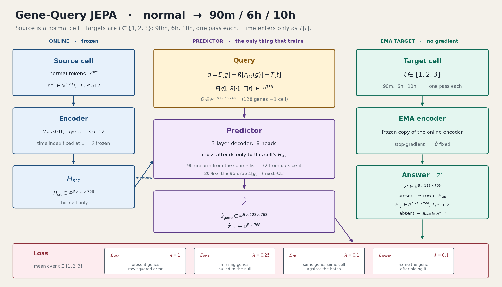
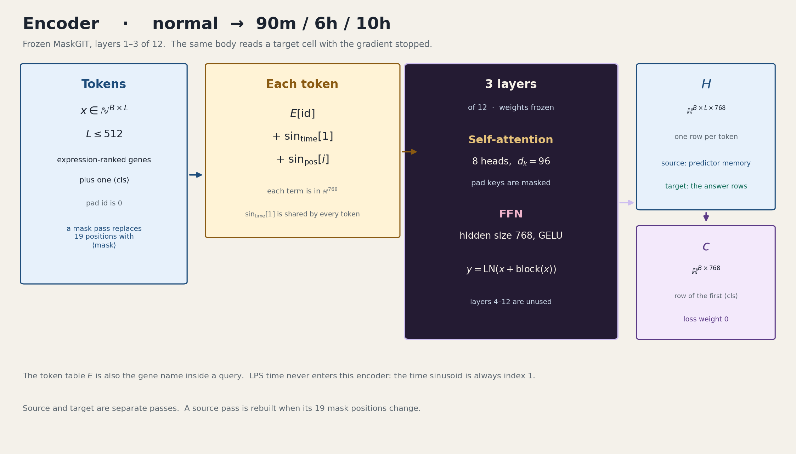
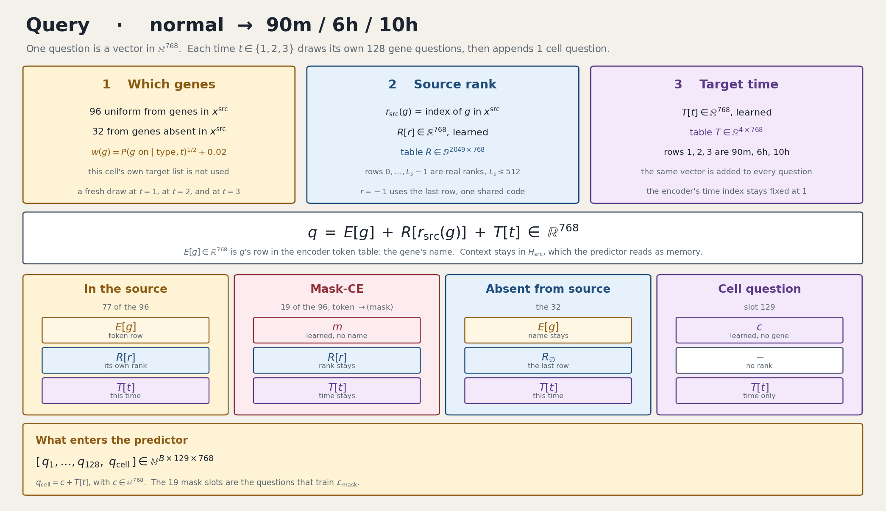
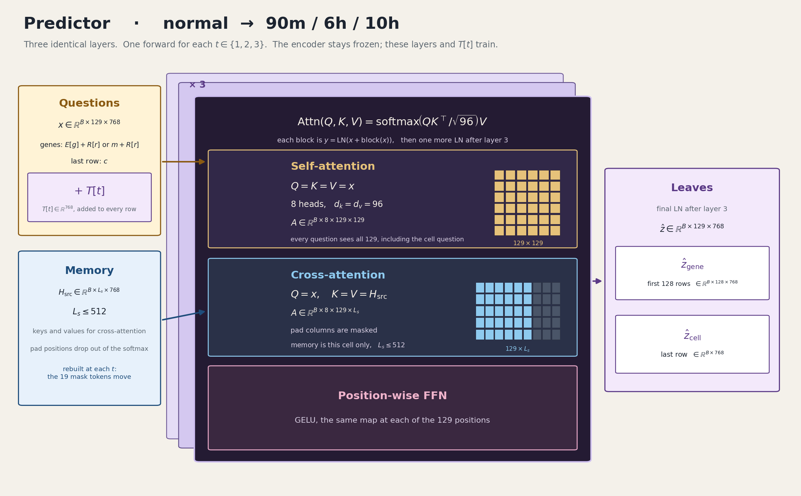
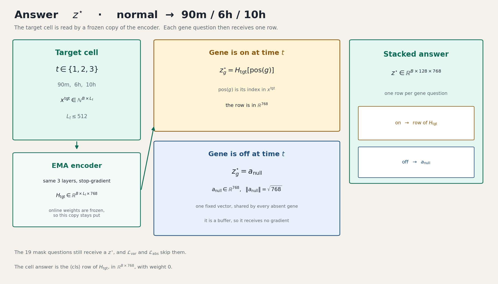
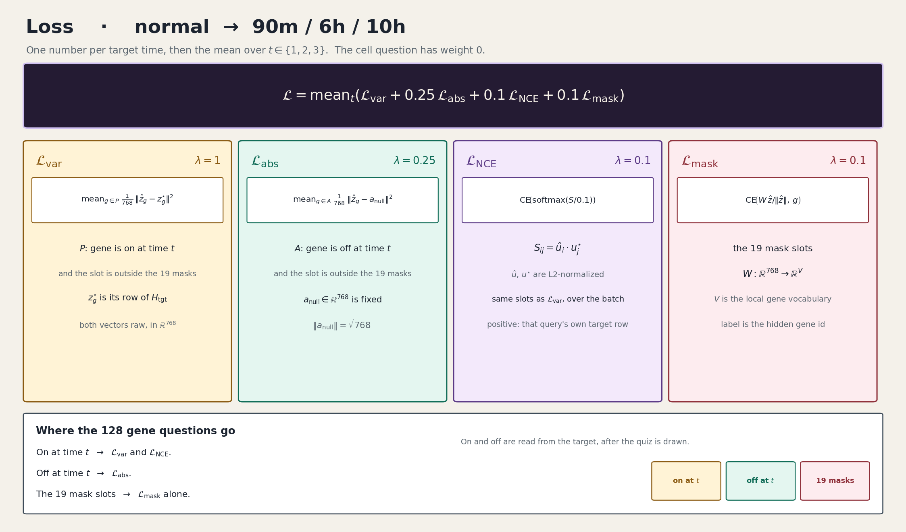

# Gene-Query JEPA

A cell at one LPS time is a ranked list of the genes it expresses. Gene-Query JEPA reads that list and answers a short quiz: for 128 chosen genes, what should each gene's embedding be at a later time?

The encoder is a frozen slice of the pretrained MaskGIT backbone. The thing that learns the transition is a small predictor. It never sees the target cell. It sees the source cell as memory, and a set of questions that name a gene, say where that gene sat in the source list, and name the time being asked about.

A second stage, trained after the JEPA is frozen, turns those predicted embeddings into counts on a fixed panel of 2,000 highly variable genes. That count head is what we use for the in-silico IL1B knockout.

The figures below are the **normal → 90 min / 6 h / 10 h** model (notebook 08). The IL1B knockout line uses the same blocks with a different quiz; that difference is in [The knockout line](#the-knockout-line).

To run tokenization, both trainings, the embedding dump, and the IL1B knockout from the shell, use [GENE_QUERY_RUN.md](GENE_QUERY_RUN.md).



## What a training step is

Each example is one source cell and its paired cells at the later times. On the atlas, the source is a resting cell (`normal`) and the targets are 90 min, 6 h, and 10 h after LPS. Each target time is a separate forward pass. The three losses are averaged.

For one time *t*:

1. Draw 128 gene questions for this cell.
2. Encode the source cell. That tensor is memory. It is not updated by the predictor's loss while the encoder is frozen.
3. Encode the target cell with a stop-gradient copy of the same encoder. Its rows are the answers.
4. The predictor reads the questions and the source memory, and emits one vector per question.
5. Present genes are pulled toward their target row. Absent genes are pulled toward one shared null vector.

The cell itself is one extra question, appended after the 128 genes. Its loss weight is zero. It is there so a gene question can attend to a cell-level slot, and so we can log a cell embedding.

## Encoder



A cell arrives as integer token ids, length at most 512, ordered by expression, plus one CLS token. Each token is the sum of three vectors in R^768: the gene-name row from the pretrained table, a time sinusoid, and a position sinusoid.

The time sinusoid is index 1 for every token. LPS time does not enter the encoder. The same body reads a source cell and, with the gradient stopped, a target cell.

The network is layers 1–3 of the 12-layer MaskGIT encoder. Each block is self-attention (8 heads, head size 96) and a feed-forward of width 768 with GELU, wrapped as a pre-norm residual. Layers 4–12 are unused. Padding positions are masked in the attention.

The figures are drawn with those three layers frozen, which is how a run starts. The 100-epoch atlas checkpoint (`fzT` in the run name) later unfreezes them. While they are frozen, the EMA target stays frozen too.

Two tensors come out:

- *H*, one row per token. The source *H* is the predictor's memory. The target *H* supplies the answer rows.
- *C*, the first CLS row. It is the cell vector used in the embedding notebooks. The cell question's loss weight is zero, so *C* is not what the gene loss trains.

## Query



One question is a vector in R^768:

```
q = E[g] + R[r_src(g)] + T[t]
```

- *E[g]* is the gene's row in the same token table the encoder uses. It is the gene's name.
- *R[r]* is a learned rank table. *r* is the gene's index in this cell's source list (0 … *L*−1). A gene that is absent from the source uses one shared code, the last row of *R*, written *R*∅.
- *T[t]* is a learned time vector, the same vector added to every question in that forward pass. Rows 1, 2, 3 are 90 min, 6 h, and 10 h.

Context stays in *H*_src. The question does not contain the other genes. The predictor reads those from memory.

On the atlas quiz drawn in the figure, 96 of the 128 genes are drawn uniformly from genes in the source list, and 32 are drawn from genes outside it, with weights *P(gene on | cell type, t)*^1/2 + 0.02. The cell's own target list is not used to choose the questions. A fresh quiz is drawn at each time.

Of the 96 source-side questions, about 19 have their name *E[g]* replaced by a learned mask vector *m*. Rank and time stay. Those slots are the mask-CE questions: the model must name the gene after the name was hidden. The rank code stays, so the question still says where in the source list the hidden gene sat.

The 129th slot is a cell question: a learned vector *c* plus *T[t]*, with no gene and no rank.

## Predictor



The predictor is a 3-layer Transformer decoder, 8 heads, head size 96. It is the module that trains when the encoder is frozen. The same weights are used for every target time; *T[t]* is what makes the three passes different.

Each layer does three things, then a residual layer-norm:

1. **Self-attention** over all 129 questions, including the cell question. A gene's prediction depends on which other genes are in the quiz. Training quizzes are width 128. Asking a different width at inference changes that context even if the weights are frozen.
2. **Cross-attention** with queries = the 129 question states, and keys and values = this cell's *H*_src only. Pad columns are masked. Memory is not mixed across the batch.
3. **Feed-forward**, GELU, applied at each of the 129 positions. In code this width is 4 × 768. The encoder block above keeps its own feed-forward at 768. Those are different layers.

The first 128 output rows are the gene predictions *ẑ*_gene. The last row is *ẑ*_cell.

## Answer



The target cell is read by an exponential-moving-average copy of the encoder. While the online encoder is frozen, that copy stays put. Gradients do not flow into it.

After the quiz is drawn, each gene question is labeled from the target:

- If the gene is **on** at time *t*, the answer is that gene's row in *H*_tgt.
- If the gene is **off** at time *t*, the answer is *a*_null, one fixed buffer with norm √768, shared by every absent gene. It receives no gradient.

*a*_null is the label for "off". It is a different object from *R*∅, which is the rank code for "this question's gene was not in the source list". A gene can be absent from the source and still be on at the target time. In that case the question carries *R*∅ and the answer is a row of *H*_tgt.

The 19 masked questions still receive an answer, but the present-gene and absent-gene losses skip them. Only the mask loss uses those slots. The cell answer is the CLS row of *H*_tgt, with weight 0.

## Loss



One number per target time, then the mean over *t* ∈ {1, 2, 3}:

```
L = mean_t ( L_var + 0.25 L_abs + 0.1 L_NCE + 0.1 L_mask )
```

| Term | Weight | Which questions | What it matches |
|---|---|---|---|
| *L*_var | 1 | On at time *t*, and not one of the 19 masks | Squared error between *ẑ* and that gene's row of *H*_tgt |
| *L*_abs | 0.25 | Off at time *t*, and not one of the 19 masks | Squared error between *ẑ* and *a*_null |
| *L*_NCE | 0.1 | Same slots as *L*_var | InfoNCE: this query should match its own target row against the other rows in the batch |
| *L*_mask | 0.1 | The ~19 slots whose name was replaced by *m* | Cross-entropy of the hidden gene id |

The cell question is in the forward pass and has weight 0. On and off are read from the target after the quiz is drawn, so the sampler itself does not need the label.

## From embeddings to counts

The JEPA predicts embeddings, not counts. Expression on the 2,000-gene panel comes from a second model, trained with the JEPA frozen.

One source cell is encoded, a 128-question quiz is drawn, and the predictor emits *ẑ*. The count head averages only the rows whose genes are present, L2-normalizes that 768-vector, and passes it through a ZINB head: a softmax over 2,000 genes for proportions, and a second linear map for dropout logits. The mean count is the proportion times the cell's observed library size. The training loss is the ZINB negative log-likelihood. Mean squared error is logged and is not the objective.

The 2,000 output columns are a fixed gene order for every cell. A gene does not have to be one of the 128 questions for the head to emit its count. IL1B's count is produced whether or not IL1B was in the quiz.

## The knockout line

The IL1B experiment asks a different question from notebook 08. The source is a cell at **90 min** after LPS, and the targets are **6 h and 10 h**. On that corpus, `--pred-tps 1,2` means those two times. The time labels are read from the filenames.

Both knockout JEPAs are **source-blind**. The quiz is built only from the source list and from population frequencies *P(gene on | cell type, time)*. This cell's own target gene list is not used to choose questions.

The line we compare with MaskGIT draws the 128 questions as:

- 64 uniform from genes in the source list,
- 48 genes that are **not** in the source, chosen as the most common at that cell type and time,
- 16 weighted-random from the rest, biased toward genes that are usually off.

Its contrastive weight is 0. The count head on top of it is the pooled head above, trained for 25 epochs (`20261013_172837`, best validation MSE 5.18 at epoch 22). The JEPA checkpoint under it is `20261012_160033`.

An older source-blind line (96 source questions, no top-common block, JEPA `20261001_143041`, count head `20261001_202210`) is kept as the second JEPA column.

Knockout inference does not generate a new token sequence. IL1B (`ENSG00000125538`) is replaced by `<mask>` in the source gene list, the quiz is resynced so that if IL1B had been a source question its rank becomes −1, and the frozen count head emits counts. The control pass is the same cell with IL1B left in the source. Notebook 07 and `KO_comparison` read those paired counts.

MaskGIT's knockout is the benchmark. It edits the token sequence the same way (IL1B → mask) and decodes with its own count head. The two families are compared on the same cells, the same gene, and the same two times. They are not the same architecture.

## Notebooks

Notebooks 01–07 are the PerturbGen LPS tutorial this fork trains and perturbs against. Notebook 08 and `KO_comparison` are the Gene-Query analyses.

| Notebook | What it does |
|---|---|
| [01 Preprocessing](examples/01_preprocessing_curation.ipynb) | Background on how the LPS atlas was assembled. The runnable path starts at notebook 02, from the pre-built `lps_otar.h5ad`. |
| [02 Tokenize and pair](examples/02_tokenization_pairing.ipynb) | Two separate datasets. **Part A:** resting source `normal` → 90 min, 6 h, 10 h (`LPS_all_tps_2k`). Used by notebooks 03–05 and by notebook 08. **Part B:** source `90m_LPS` → 6 h, 10 h (`lps_90min_perturb`). Used by the IL1B knockout. |
| [03 Train MaskGIT](examples/03_train_perturbgen.ipynb) | Trains the resting-source MaskGIT decoder and its count head on Part A, frozen 90/10 split. These checkpoints feed notebooks 04 and 05. They are not the 90 min-source knockout checkpoints. |
| [04 Gene embeddings](examples/04_GeneEmbedding_Extraction.ipynb) | Dumps MaskGIT cell and gene embeddings for every paired cell. Representation analysis, not a held-out score. |
| [05 Gene programs](examples/05_GeneProgram_Discovery.ipynb) | Leiden programs on the notebook 04 embeddings. Descriptive. A program name here is not a knockout result. |
| [06 Perturbation](examples/06_perturbation.ipynb) | In-silico IL1B knockout with the **90 min-source MaskGIT** count checkpoint. The effect is the paired difference between a control forward pass and an IL1B-masked forward pass on the same 90 min cell. |
| [07 Post-perturbation](examples/07_PostPerturbation_Analyses.ipynb) | MaskGIT only. Reads the notebook 06 `.h5ad` (`X` = knockout counts, `layers['pred_counts']` = control) and plots DEG counts by cell type at 6 h and 10 h. |
| [08 JEPA embeddings](examples/08_GeneQuery_JEPA_Embedding_Analysis.ipynb) | The same cell UMAP and gene-program analysis as notebooks 04–05, for one JEPA checkpoint: the 100-epoch atlas run `20260926_232131` (gene MSE, contrastive 0.1, mask-CE, source rank in the query). |
| [KO comparison](examples/KO_comparison.ipynb) | MaskGIT, the older source-blind JEPA, and the qsb64 JEPA, on the same IL1B knockout. Gene-effect summaries, the six-gene boxplots (panel f), and the pathway mirror against the Parse IL-1β screen (panel i). |

Panel i is also a script: [`examples/panel_i_pathway_mirror.py`](examples/panel_i_pathway_mirror.py). It aggregates IL-1β differential expression from the Parse 10M PBMC cytokine screen (CD14 monocytes, CD16 monocytes, and cDCs), runs Reactome enrichment, and scores whether the knockout moves those genes in the opposite direction. The DEG table is ~200 MB and is not in git; see [`examples/external/parse10m/README.md`](examples/external/parse10m/README.md).

Training curves for the four kept runs: [`examples/jepa_full_res/plot_full_jepa_curves.py`](examples/jepa_full_res/plot_full_jepa_curves.py). Which checkpoints and dumps are still on disk: [`examples/KEEP.md`](examples/KEEP.md).

## Requirements

Python 3.11. From the repository root:

```bash
poetry env use python3.11
poetry install
source "$(poetry env info -p)/bin/activate"
```

`pyproject.toml` and `poetry.lock` are the dependency pins. `requirements.txt` lists the direct packages only.

Notebooks 01, 02, and 07 run on CPU. A machine with at least 32 GB of RAM is the practical size for the LPS h5ad files. Training and knockout inference need a CUDA GPU. The MaskGIT tutorials use batch size 64, which wants about 40 GB. On a 24 GB card, lower the batch size. Gene-Query training in the kept runs used batch size 16 (JEPA) and 32 (count head).

```bash
export WANDB_MODE=offline
```

Use that on a machine without Weights & Biases access. `--wandb_mode disabled` turns logging off.

Commands for training, the count head, and an embedding dump are in [`examples/GENE_QUERY_JEPA.md`](examples/GENE_QUERY_JEPA.md). `--pred-tps` is one comma-separated token (`1,2` or `1,2,3`).

Checkpoints and knockout `.h5ad` files live on the cluster, not in this repository. Paths are in `KEEP.md` and in `examples/configs/ko/`.
